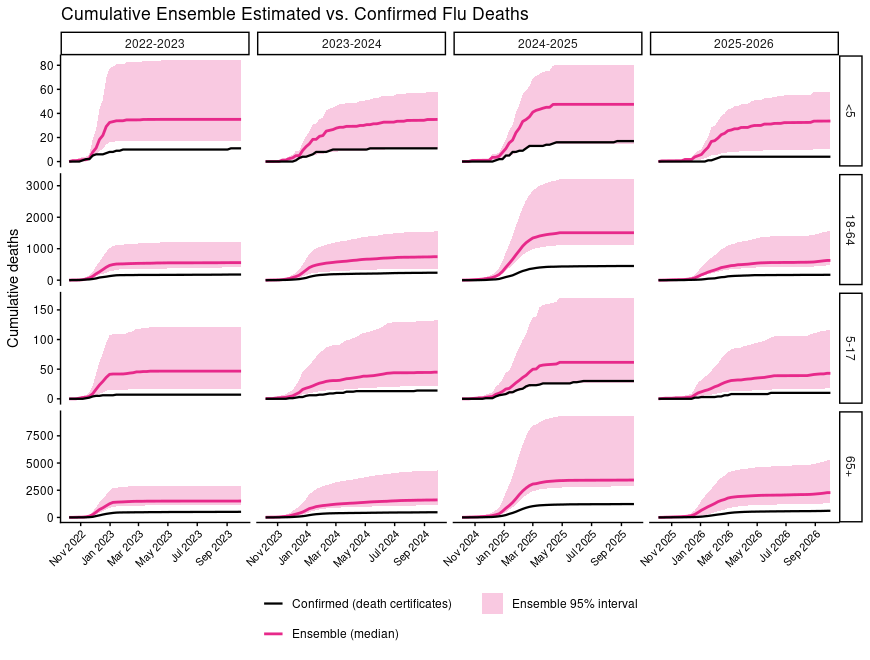

# California Influenza Adjusted Deaths

## Data Sources

This analysis draws on four California-specific and national data sources:

- **NHSN hospitalization data** (
  [CDC NHSN Hospital Respiratory Data](https://www.cdc.gov/nhsn/psc/hospital-respiratory-reporting.html)
  ) offers near-universal, mandatory, lab-confirmed influenza hospitalization 
  counts reported by California facilities, though only at a coarse 4-group age 
  resolution (<5, 5-17, 18-64, 65+). 
- **CA death certificate data** provides California-specific influenza-coded 
  deaths with full age and geographic detail.
- **FluSurv-NET** (
  [CDC FluView Interactive — FluSurv-NET Hospitalization Rates](https://www.cdc.gov/fluview/overview/influenza-hospitalization-surveillance.html); 
  data accessible via [FluView GRASP](https://gis.cdc.gov/grasp/fluview/FluHospRates.html)) 
  supplies weekly, age-stratified (7-group) hospitalization rates per 100,000 
  catchment population from CDC's Emerging Infections Program surveillance 
  network, with a Northern California catchment spanning Alameda, Contra Costa, 
  and San Francisco counties — the same underlying system CDC uses to build 
  its national flu burden estimates, making it directly comparable to CDC's 
  published adjustment ratios. These are supplemented by two national 
  reference tables: 
- **CDC's flu disease burden model inputs** (
  [Estimated US Flu Disease Burden Dashboard](https://www.cdc.gov/flu-burden/php/data-vis/index.html)), 
  providing national hospitalization under-detection adjustments and 
  death-to-hospitalization ratios by age/season.
- **NCHS national mortality surveillance** (
  [NCHS Mortality Surveillance System, P&I/Influenza Mortality](https://gis.cdc.gov/GRASP/Fluview/mortality.html)), 
  providing national influenza-coded death totals, available only from the 
  2018-19 season forward and only at the all-ages level.

## Methods

**Method 1 (National multipliers)** extrapolates CA's FluSurv-NET 
hospitalization rate to the statewide population, calibrates it against actual 
NHSN hospitalization counts (to correct for the fact that the EIP catchment may 
not perfectly represent the rest of the state), and then applies CDC's national 
hospitalization under-detection adjustment and death-to-hospitalization ratio 
to arrive at estimated deaths. This methodology roughly follows the flu burden 
cascade process outlined in 
[Reed et al. (2015)](https://journals.plos.org/plosone/article?id=10.1371/journal.pone.0118369).

**Method 1 (CA multipliers)** follows an identical hospitalization-extrapolation 
pathway, but substitutes CDC's national under-detection adjustment with a 
CA-specific adjustment built from state testing-sensitivity and 
testing-proportion data (provided by the CDC), weighted by implied FluSurv-NET
hospitalization volume. 

**Method 2 (Death-certificate scaling)** takes an entirely different approach: 
it reconstructs CDC's implied national under-ascertainment multiplier (the ratio 
of CDC's nationally estimated deaths to NCHS's nationally reported flu-coded 
deaths) and applies that multiplier directly to California's own observed 
flu-coded death certificates, scaling up CA's real death-certificate counts 
rather than working forward from hospitalizations at all.

## Key Assumptions and Limitations

**Method 1 (both variations)** assumes that age-specific hospitalization rates 
observed in the Northern California EIP catchment counties are representative 
of statewide rates — a standard assumption in CDC's own national methodology, 
but one that may not hold if testing practices, care-seeking behavior, or 
population risk factors differ meaningfully between the catchment counties and 
the rest of California. Because the two data sources use incompatible age 
schemes (FluSurv-NET's 7 groups vs. NHSN's 4), hospitalization counts had to 
be re-aggregated to a common scheme before calibration, and the calibration 
ratio itself was found to stabilize only toward the end of each season — so 
season-total (rather than week-specific) calibration ratios were used, with a 
cross-season mean as a fallback for seasons lacking sufficient data. 

The **CA-multiplier variation** additionally depends on how its underlying 
sensitivity/testing-proportion data are weighted when aggregating across age 
groups; the most defensible approach (weighting by implied hospitalization 
volume) was used where possible, falling back to population-weighting or an 
unweighted mean where volume data were unavailable — meaning the CA-specific 
adjustment carries uncertainty that is likely understated by point estimates 
alone. 

**Method 2** depends entirely on the national multiplier (CDC-estimated deaths 
÷ NCHS-coded deaths) being a reasonable proxy for California's own true 
under-ascertainment and is further constrained by lack of age stratification, 
which required collapsing CDC's age-specific estimates to an all-ages total 
before the multiplier could be constructed. Across all three methods, no 
uncertainty intervals are currently propagated beyond what's directly 
observable in the input data, since CDC's public burden-model inputs are point 
estimates only.

## Uncertainty Propagation and Ensemble Methodology

To move beyond point estimates, we propagated uncertainty through each of the 
three estimation approaches using a bootstrap and Monte Carlo simulation 
framework, then combined the results into a pooled ensemble. Rather than 
treating the various adjustment ratios (hospitalization under-detection, 
death-to-hospitalization ratios, NHSN-FluSurv-NET calibration ratios, and the 
national death-certificate scaling multiplier) as fixed constants, we modeled 
each as a distribution built from the historical spread of season- and 
age-specific values. For seasons and age groups with their own directly 
observed ratio, we used a weighted-anchor bootstrap that draws predominantly 
(70% of the time) from that season's own value while still drawing occasionally 
from the broader historical observed values. Seasons lacking season-specific 
data draw entirely from the pooled historical spread resulting in a wider 
sampling that reflects genuine uncertainty. Observed hospitalization and death 
counts themselves were treated using a Gamma-Poisson posterior (rather than as 
exact fixed values or standard Poisson sampling), which avoids an artificial 
collapse to zero-width intervals in sparse pediatric age groups (<5, 5-17) 
where weekly counts are frequently zero but true underlying risk is not.

Each method's ratios were combined multiplicatively across hundreds of 
simulated draws to produce a full distribution of plausible weekly and 
season-total death estimates for Method 1 (both national- and CA-multiplier 
variants) and Method 2. To arrive at a single combined estimate, we used a 
pooled ensemble approach: all simulated draws from the three methods are 
concatenated into one distribution at each season/age-group, and the median 
and 95% interval are taken directly from that pooled set. This approach is 
intentionally conservative — it reflects both the within-method statistical 
uncertainty and the across-method disagreement simultaneously, without 
assuming the three methods are independent (since all three ultimately rely on 
shared CDC-derived inputs somewhere in their respective chains). An 
inverse-variance weighted ensemble, which down-weights methods with wider 
individual uncertainty, was also computed as a sensitivity check but is not 
used as the primary reported estimate, given the likely correlation between 
methods. Taken together, this framework allows us to report not just a single 
"best guess" of California's influenza death burden, but a defensible range 
that reflects genuine data limitations — including thin historical reporting, 
known data artifacts, and irreducible disagreement between independent 
estimation strategies.
